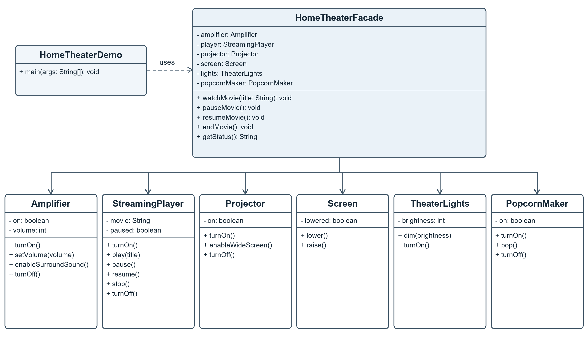

# Vault Backup Facade

An educational Java 17 implementation of the Facade pattern. `VaultBackupFacade` turns a multi-step backup workflow into three client operations: create, verify, and restore.

## Why a facade

A backup client would otherwise need to discover files, calculate SHA-256 checksums, build a versioned manifest, assemble a ZIP archive, open that archive, and compare each stored file with its manifest entry. The facade coordinates these steps and applies the correct order. The subsystem classes remain independent and can still be used by advanced clients.

## Requirements

- JDK 17 or later
- Maven 3.8 or later

## Build

```shell
mvn clean package
```

## Run

```shell
java -jar target/facade-backup-1.0.0.jar backup ./sample-data ./sample-backup.zip
java -jar target/facade-backup-1.0.0.jar verify ./sample-backup.zip
java -jar target/facade-backup-1.0.0.jar restore ./sample-backup.zip ./restored-data
```

Restore requires a new or empty destination directory. Verification reports missing files, size mismatches, and checksum mismatches. The archive contains the original relative paths and a UTF-8 TSV manifest at `META-INF/backup-manifest.tsv`.

## Design



The CLI client calls only `VaultBackupFacade`. The facade coordinates `BackupFileCollector`, `ChecksumService`, `ManifestCodec`, `ArchiveAssembler`, and `ArchiveInspector`. The subsystem classes do not refer back to the facade.

See [the assignment report](reports/facade-pattern-report.docx) for the introduction, UML explanation, five Clean Code principles with before-and-after excerpts, and conclusion.

## Project structure

```text
src/main/java/edu/aitu/facadebackup/
  client/       BackupCli
  domain/       BackupEntry, VerificationReport
  facade/       VaultBackupFacade
  subsystem/    file collection, checksums, manifest, archive assembly and inspection
docs/           UML class diagram
reports/        English assignment report
```
